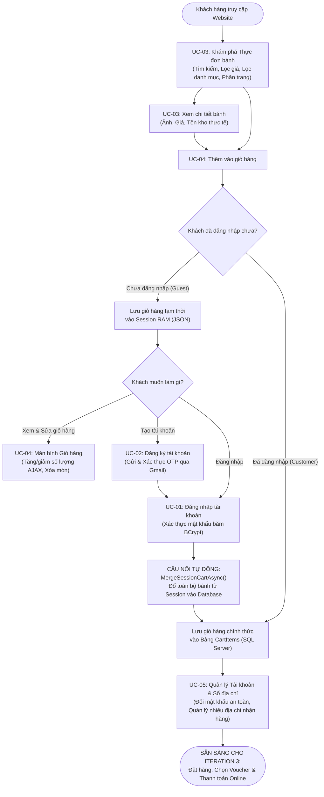
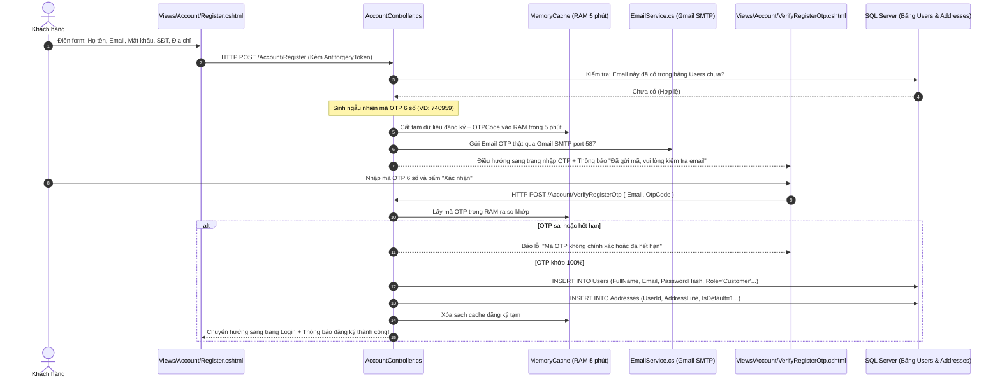
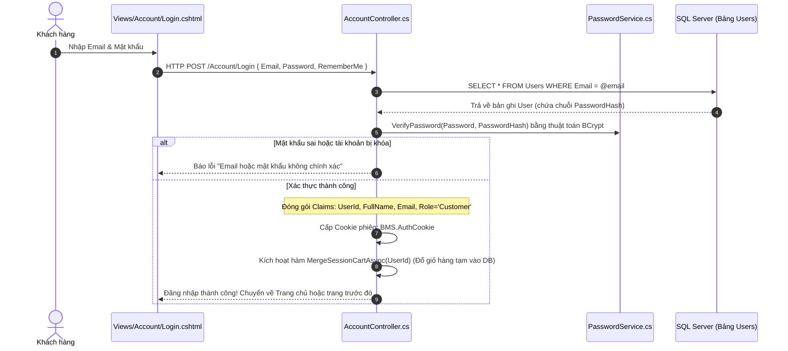
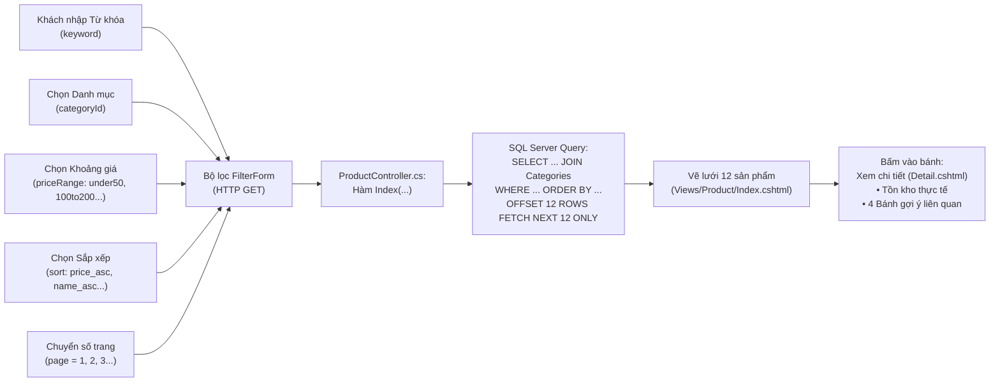
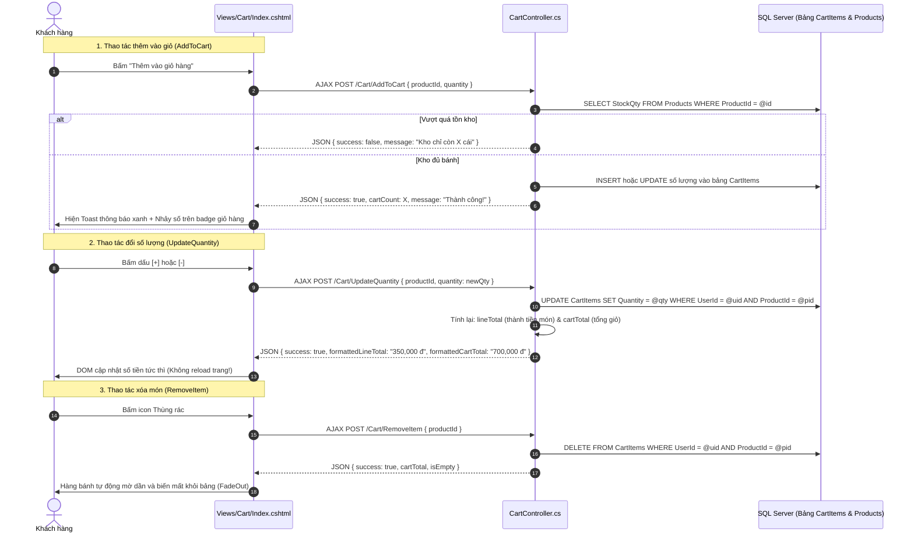
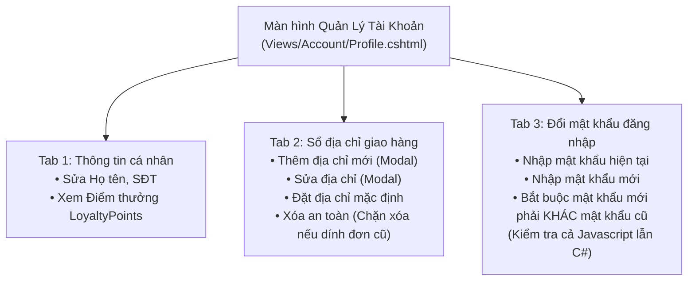

# TÀI LIỆU QUY TRÌNH WORKFLOW PHÂN HỆ KHÁCH HÀNG (CUSTOMER)
## DỰ ÁN: BAKERY MANAGEMENT SYSTEM (BMS) — SWP391 (GROUP 5)
**Người phụ trách phân hệ:** TrungNK  
**Phạm vi:** Toàn bộ luồng nghiệp vụ từ **Iteration 1** đến **Iteration 2**  
**Trạng thái:** Đã hoàn thành 100% và kiểm thử nghiệm thu  

---

## 1. TỔNG QUAN HÀNH TRÌNH KHÁCH HÀNG (CUSTOMER JOURNEY)

Trong hệ thống BMS, phân hệ **Khách hàng (Customer)** được thiết kế bám sát hành vi mua sắm thực tế của người dùng: bắt đầu từ việc khám phá sản phẩm, chọn mua bánh, xác thực tài khoản qua email, quản lý giỏ hàng đến lưu trữ sổ địa chỉ giao hàng để chuẩn bị cho bước thanh toán (Checkout ở Iteration 3).

---

## 2. CHI TIẾT TỪNG CHẶNG TRONG WORKFLOW

### CHẶNG 1: ĐỊNH DANH & XÁC THỰC EMAIL (UC-01 & UC-02)

#### 1.1. Luồng Đăng Ký Tài Khoản & Xác Thực OTP (Register with OTP)
Mục tiêu: Đảm bảo 100% email là thật, loại bỏ tài khoản ảo/rác.

- **File Frontend:**
  - Form điền thông tin: `Views/Account/Register.cshtml`
  - Màn hình nhập OTP: `Views/Account/VerifyRegisterOtp.cshtml`
- **File Backend:**
  - Xử lý nghiệp vụ: `Controllers/AccountController.cs` (Dòng 141–328)
  - Dịch vụ gửi thư SMTP: `Services/EmailService.cs` (Dòng 84–152)

---

#### 1.2. Luồng Đăng Nhập & Phân Quyền (Login & Role Cookie)
Mục tiêu: Cấp vé vào cửa an toàn và nhận diện vai trò `Customer`.

- **File Frontend:** `Views/Account/Login.cshtml`
- **File Backend:** `Controllers/AccountController.cs` (Dòng 43–118)

---

#### 1.3. Luồng Quên Mật Khẩu (Forgot & Reset Password)
- Khi quên mật khẩu, khách chỉ cần nhập email tại `Views/Account/ForgotPassword.cshtml`.
- Backend kiểm tra tài khoản, sinh mã OTP khôi phục gửi qua email thật.
- Khách xác thực OTP tại `Views/Account/VerifyForgotOtp.cshtml`.
- Sau khi xác thực đúng, hệ thống cấp một `ResetToken` có hiệu lực 15 phút và cho phép khách nhập mật khẩu mới tại `Views/Account/ResetPassword.cshtml`.

---

### CHẶNG 2: TÌM KIẾM, LỌC & XEM CHI TIẾT SẢN PHẨM (UC-03)

Mục tiêu: Giúp khách dễ dàng tìm được chiếc bánh yêu thích theo ngân sách và sở thích.

#### Các thông số bộ lọc chuẩn xác:
1. **Từ khóa:** Tìm kiếm không phân biệt hoa thường trên cả `Name` và `Description`.
2. **Danh mục:** Bánh kem, Bánh mì, Bánh ngọt, Bánh quy...
3. **Khoảng giá phân khúc thị trường:**
   - Dưới 50.000đ (`under50`): $0 \le Price \le 50.000$
   - 50.000đ – 100.000đ (`50to100`): $50.000 \le Price \le 100.000$
   - 100.000đ – 200.000đ (`100to200`): $100.000 \le Price \le 200.000$
   - 200.000đ – 300.000đ (`200to300`): $200.000 \le Price \le 300.000$
   - 300.000đ – 400.000đ (`300to400`): $300.000 \le Price \le 400.000$
   - Trên 400.000đ (`over400`): $Price \ge 400.000$
4. **Trang Chi tiết bánh (`/Product/Detail/{id}`):**
   - Bộ chọn số lượng có chặn trên bằng số lượng thực tế trong kho (`StockQty`).
   - Tích hợp nút **"Thêm vào giỏ"** và nút **"Mua ngay"** (chuyển thẳng tới giỏ hàng).

- **File Frontend:** `Views/Product/Index.cshtml` và `Views/Product/Detail.cshtml`
- **File Backend:** `Controllers/ProductController.cs` (Dòng 18–140)

---

### CHẶNG 3: GIỎ HÀNG TRỰC TUYẾN ĐA LUỒNG (UC-04)

Mục tiêu: Đảm bảo trải nghiệm thêm và sửa giỏ hàng mượt mà không cần tải lại trang, đồng thời lưu trữ bền vững.

#### 3.1. Kiến Trúc Lưu Trữ Kép (Dual-Storage Architecture)
- **Khách vãng lai (Chưa đăng nhập):** Giỏ hàng lưu trong **Session RAM** (`BMS_Cart_Session`) dưới dạng chuỗi JSON `{"1": 2, "2": 3}`.
- **Thành viên (Đã đăng nhập):** Giỏ hàng lưu trực tiếp vào bảng **`CartItems`** trong Database SQL Server.

- **File Frontend:** `Views/Cart/Index.cshtml` và nút dùng chung tại `Views/Shared/_Layout.cshtml` (dòng 111–124)
- **File Backend:** `Controllers/CartController.cs` (Toàn bộ controller)

---

### CHẶNG 4: QUẢN LÝ TÀI KHOẢN & SỔ ĐỊA CHỈ NHẬN HÀNG (UC-05)

Mục tiêu: Khách hàng làm chủ thông tin cá nhân, tích lũy quyền lợi và thiết lập sẵn địa chỉ nhận bánh để checkout thần tốc.

#### Quy tắc nghiệp vụ đặc biệt đã được hoàn thiện:
1. **Đổi mật khẩu an toàn:**
   - Hệ thống chặn ngay lập tức nếu khách nhập mật khẩu mới trùng với mật khẩu hiện tại.
   - Kiểm tra 2 lớp: Lớp 1 chặn ngay tại trình duyệt qua Javascript (hiển thị thông báo đỏ `#passwordErrorAlert`), Lớp 2 xác thực mã băm BCrypt tại server `Controllers/AccountController.cs` (dòng 688–697).
2. **Sổ nhiều địa chỉ giao hàng (`Addresses`):**
   - Cho phép 1 khách hàng lưu nhiều địa chỉ (Nhà riêng, Công ty, Nhà bố mẹ...).
   - Khi chọn một địa chỉ làm mặc định (`IsDefault = 1`), hệ thống tự động hạ tất cả địa chỉ còn lại về `IsDefault = 0`.
   - **Xóa an toàn (Referential Integrity):** Trước khi xóa địa chỉ, Backend kiểm tra trong bảng `Orders`. Nếu địa chỉ này đã từng được sử dụng để giao một đơn hàng trong quá khứ, hệ thống sẽ từ chối xóa để giữ nguyên lịch sử kế toán và vận chuyển.

- **File Frontend:** `Views/Account/Profile.cshtml`
- **File Backend:** `Controllers/AccountController.cs` (Dòng 544–865)

---

## 3. MA TRẬN ÁNH XẠ FILE — HÀNH ĐỘNG — DATABASE (TRACEABILITY MATRIX)

| Hành động của khách | Giao diện Frontend | Phương thức truyền | Bộ xử lý Backend (Controller) | Tương tác Database (SQL/EF Core) |
| :--- | :--- | :--- | :--- | :--- |
| **Đăng ký tài khoản** | `Account/Register.cshtml` | Form POST | `AccountController.Register` | Lưu tạm vào `MemoryCache` RAM 5 phút |
| **Xác thực OTP** | `Account/VerifyRegisterOtp.cshtml` | Form POST | `AccountController.VerifyRegisterOtp` | `INSERT INTO Users`, `INSERT INTO Addresses` |
| **Đăng nhập** | `Account/Login.cshtml` | Form POST | `AccountController.Login` | `SELECT Users`, Gộp giỏ `MergeSessionCartAsync` |
| **Lọc danh sách bánh** | `Product/Index.cshtml` | URL GET | `ProductController.Index` | `SELECT Products JOIN Categories WHERE... OFFSET...` |
| **Xem chi tiết bánh** | `Product/Detail.cshtml` | URL GET | `ProductController.Detail` | `SELECT Products WHERE ProductId = @id` |
| **Thêm vào giỏ** | `Product/Detail.cshtml` | AJAX POST | `CartController.AddToCart` | `INSERT/UPDATE CartItems` hoặc ghi `Session` |
| **Tăng/giảm số lượng** | `Cart/Index.cshtml` | AJAX POST | `CartController.UpdateQuantity` | `UPDATE CartItems SET Quantity = @qty` |
| **Xóa món khỏi giỏ** | `Cart/Index.cshtml` | AJAX POST | `CartController.RemoveItem` | `DELETE FROM CartItems WHERE ProductId = @id` |
| **Cập nhật thông tin** | `Account/Profile.cshtml` | Form POST | `AccountController.Profile` | `UPDATE Users SET FullName = @name...` |
| **Đổi mật khẩu** | `Account/Profile.cshtml` | Form POST | `AccountController.ChangePassword` | `UPDATE Users SET PasswordHash = @hash` |
| **Thêm địa chỉ mới** | `Account/Profile.cshtml` | Form POST | `AccountController.AddAddress` | `INSERT INTO Addresses` |
| **Đặt địa chỉ mặc định**| `Account/Profile.cshtml` | Form POST | `AccountController.SetDefaultAddress`| `UPDATE Addresses SET IsDefault = 0/1` |
| **Xóa địa chỉ** | `Account/Profile.cshtml` | Form POST | `AccountController.DeleteAddress` | `DELETE FROM Addresses` (Sau khi check `Orders`) |

---

## 4. TỔNG KẾT BÀN GIAO ITERATION 2
- **Độ hoàn thiện:** 100% các Use Case được giao (UC-01, UC-02, UC-03, UC-04, UC-05).
- **Chất lượng code:** Biên dịch không lỗi (`0 Error(s)`, `0 Warning(s)`), mã hóa chuẩn UTF-8 with BOM, không lỗi font chữ (mojibake).
- **Sẵn sàng:** Dữ liệu giỏ hàng và sổ địa chỉ đã nằm sẵn sàng trong Database, tạo tiền đề vững chắc để tiếp tục triển khai **UC-06: Checkout & Đặt hàng** ở Iteration 3.
