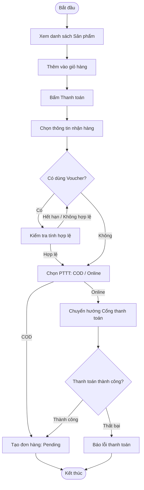
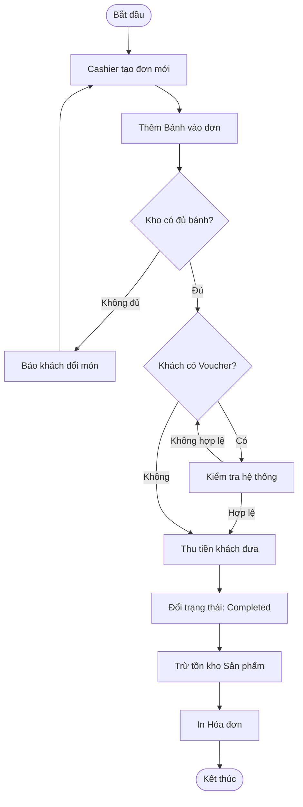
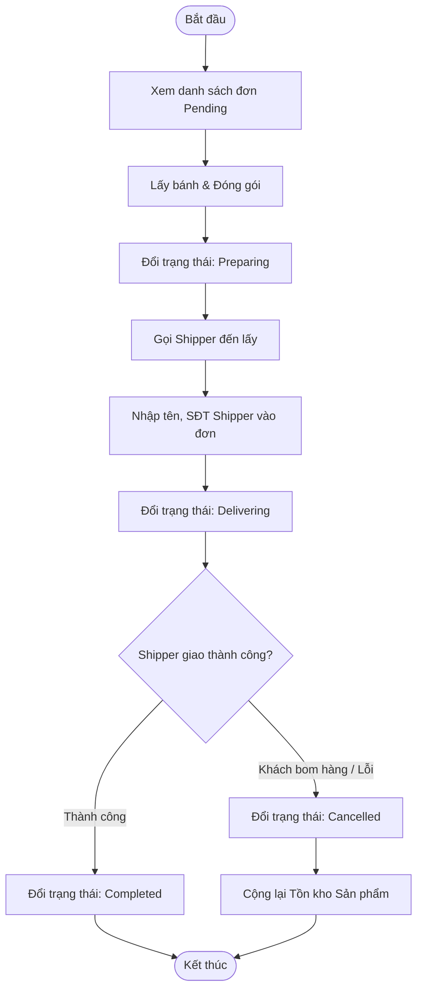
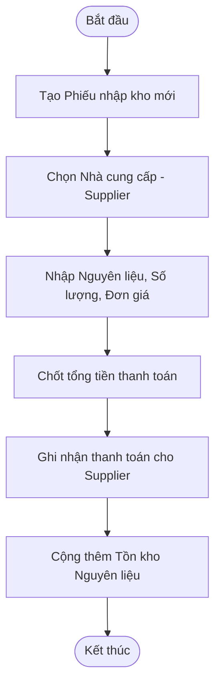
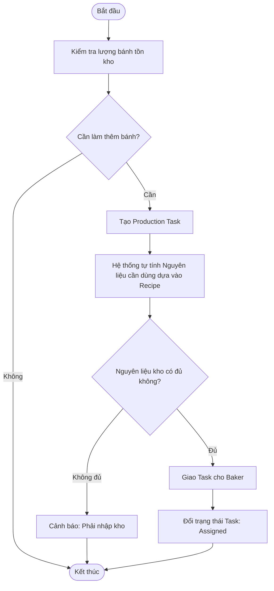
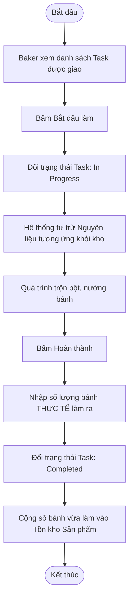

# Bakery Management System - 6 Core Workflows

Tài liệu này đặc tả 6 luồng nghiệp vụ (workflow) cốt lõi của hệ thống, bao gồm các trường hợp rẽ nhánh (ngoại lệ, thành công/thất bại). Các biểu đồ được viết bằng chuẩn Mermaid, bạn có thể copy code này dán vào **[Mermaid Live Editor](https://mermaid.live/)** hoặc nhúng trực tiếp vào Notion/GitHub để xem ảnh.

---

## 1. Workflow: Khách hàng đặt hàng (Online Order)
**Actor:** Customer (User)
**Mô tả:** Khách hàng lướt web, chọn bánh, áp dụng mã giảm giá và thanh toán online hoặc nhận hàng trả tiền (COD).

---

## 2. Workflow: Bán hàng tại quầy (Counter Sale / POS)
**Actor:** Cashier
**Mô tả:** Khách đến tận tiệm mua bánh. Cashier thao tác tạo đơn, thu tiền mặt và giao bánh ngay lập tức (không có khâu giao hàng).

---

## 3. Workflow: Xử lý & Giao đơn Online (Order Fulfillment)
**Actor:** Cashier, Shipper
**Mô tả:** Nhận đơn online từ khách, đóng gói, bàn giao cho Shipper và theo dõi đến khi giao thành công.

---

## 4. Workflow: Nhập kho nguyên liệu (Goods Receipt / Procurement)
**Actor:** Admin
**Mô tả:** Admin mua nguyên liệu (bột, bơ, sữa) từ Nhà cung cấp (Supplier) để phục vụ sản xuất.

---

## 5. Workflow: Lên kế hoạch sản xuất (Production Planning)
**Actor:** Admin
**Mô tả:** Admin thấy bánh trong kho sắp hết, bèn tạo nhiệm vụ (Task) bắt Baker đi làm thêm bánh.

---

## 6. Workflow: Thực thi sản xuất (Production Execution)
**Actor:** Baker
**Mô tả:** Baker nhận lệnh từ Admin, tiến hành nướng bánh và báo cáo kết quả sau khi nướng xong.

